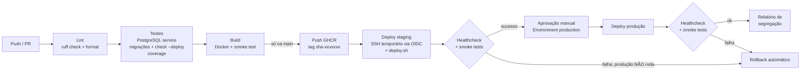

# Lacrei Saúde — API de Gerenciamento de Consultas

API RESTful para cadastro de **profissionais da saúde** e **consultas médicas**, construída para o Desafio Back-end da Lacrei Saúde com foco em qualidade de código, segurança dos dados e preparo para produção.

| | |
|---|---|
| **Stack** | Python 3.12 · Django 5.2 · Django REST Framework · PostgreSQL 16 · Poetry · Docker · GitHub Actions |
| **Autenticação** | JWT (`djangorestframework-simplejwt`) |
| **Documentação da API** | Swagger em `/api/docs/` · Redoc em `/api/redoc/` · OpenAPI em `/api/schema/` |
| **Deploy** | AWS EC2 + Docker Compose: staging e produção na **mesma instância**, isolados ([detalhes](#ambientes-staging-e-produção-na-mesma-ec2)), atrás de um único Caddy com HTTPS |
| **Staging** | https://staging.15-229-49-123.sslip.io · [Swagger](https://staging.15-229-49-123.sslip.io/api/docs/) · [/health/](https://staging.15-229-49-123.sslip.io/health/) |
| **Produção** | https://15-229-49-123.sslip.io · [Swagger](https://15-229-49-123.sslip.io/api/docs/) · [/health/](https://15-229-49-123.sslip.io/health/) |
| **Evidências da avaliação** | [docs/ENTREGA.md](docs/ENTREGA.md): commit avaliado, execução do pipeline e versões no ar |

---

## Sumário

1. [Funcionalidades](#funcionalidades)
2. [Estrutura do projeto](#estrutura-do-projeto)
3. [Endpoints](#endpoints)
4. [Setup local (Poetry)](#setup-local-poetry)
5. [Setup com Docker](#setup-com-docker)
6. [Autenticação](#autenticação)
7. [Testes](#testes)
8. [Segurança](#segurança)
9. [Logs](#logs)
10. [CI/CD](#cicd)
11. [Deploy na AWS](#deploy-na-aws)
12. [Ambientes: staging e produção na mesma EC2](#ambientes-staging-e-produção-na-mesma-ec2)
13. [Rollback](#rollback)
14. [Integração com o Asaas (bônus)](#integração-com-o-asaas-bônus)
15. [Decisões técnicas](#decisões-técnicas)
16. [Critérios de aceite](#critérios-de-aceite)
17. [Ajustes da devolutiva](#ajustes-da-devolutiva)

---

## Funcionalidades

- **CRUD de profissionais**: nome social, profissão, endereço e contato.
- **CRUD de consultas**: data/hora e profissional vinculado (chave estrangeira), além de status, valor e observações.
- **Busca de consultas pelo ID da pessoa profissional**: `GET /api/v1/consultas/?profissional_id=<id>` e `GET /api/v1/profissionais/<id>/consultas/`.
- **Regras de negócio**: consultas só em datas futuras; um profissional não pode ter duas consultas ativas no mesmo horário; profissionais com consultas e consultas com cobrança não podem ser removidos (HTTP 409), para preservar o histórico.
- **Respostas sempre em JSON**, inclusive 404 e 500.
- **Bônus**: documentação OpenAPI (Swagger/Redoc) e cobrança com **split de pagamento via Asaas** (mock por padrão, cliente real pronto para o sandbox).

## Estrutura do projeto

```
.
├── apps/
│   ├── core/           # sanitização, validadores, logs, middleware, healthcheck, erros
│   ├── profissionais/  # modelo, serializers, views e testes de profissionais
│   ├── consultas/      # modelo, serializers, views e testes de consultas
│   └── pagamentos/     # integração Asaas (cliente real + mock), cobranças e webhook
├── config/             # settings (12-factor, via variáveis de ambiente) e urls
├── deploy/             # compose de cada ambiente, proxy único (edge/), user data da EC2
├── scripts/            # entrypoint, deploy.sh, rollback.sh, smoke-test.sh, segregation-report.sh
├── docs/               # decisões, deploy AWS, rollback, logs, Asaas e evidências da entrega
├── .github/workflows/  # ci-cd.yml, deploy.yml (reutilizável) e rollback.yml
├── Dockerfile          # multi-stage, sem root, com HEALTHCHECK
└── docker-compose.yml  # ambiente local (API + PostgreSQL)
```

## Endpoints

Todos sob `/api/v1/` exigem `Authorization: Bearer <access_token>`, exceto os marcados como públicos.

| Método | Rota | Descrição |
|---|---|---|
| POST | `/api/v1/auth/token/` | **Público.** Obtém `access` e `refresh` (usuário e senha) |
| POST | `/api/v1/auth/token/refresh/` | **Público.** Renova o `access` |
| GET / POST | `/api/v1/profissionais/` | Lista (paginada, `?search=`) / cadastra |
| GET / PUT / PATCH / DELETE | `/api/v1/profissionais/{id}/` | Detalha / atualiza / atualiza parcialmente / remove |
| GET | `/api/v1/profissionais/{id}/consultas/` | Consultas da pessoa profissional |
| GET / POST | `/api/v1/consultas/` | Lista (`?profissional_id=`, `?status=`) / agenda |
| GET / PUT / PATCH / DELETE | `/api/v1/consultas/{id}/` | Detalha / atualiza / atualiza parcialmente / remove |
| GET / POST | `/api/v1/consultas/{id}/cobranca/` | Consulta / gera a cobrança Asaas com split |
| POST | `/api/v1/pagamentos/webhook/asaas/` | **Público** (autenticado pelo token do Asaas). Recebe eventos de pagamento |
| GET | `/health/` | **Público.** Healthcheck (banco + versão no ar) |
| GET | `/api/docs/` · `/api/redoc/` | **Público.** Documentação interativa |

### Exemplos

**Cadastrar profissional**

```bash
curl -X POST http://localhost:8000/api/v1/profissionais/ \
  -H "Authorization: Bearer $TOKEN" -H "Content-Type: application/json" \
  -d '{
    "nome_social": "Dra. Alex Souza",
    "profissao": "Médica de Família",
    "endereco": {
      "cep": "01310-100", "logradouro": "Avenida Paulista", "numero": "1000",
      "complemento": "Sala 12", "bairro": "Bela Vista", "cidade": "São Paulo", "uf": "SP"
    },
    "contato": { "email": "alex.souza@exemplo.com", "telefone": "(11) 99999-0000" }
  }'
```

Máscaras são aceitas e os dados são normalizados (CEP e telefone ficam só com dígitos, UF em maiúsculas, e-mail em minúsculas).

**Agendar consulta**

```bash
curl -X POST http://localhost:8000/api/v1/consultas/ \
  -H "Authorization: Bearer $TOKEN" -H "Content-Type: application/json" \
  -d '{"profissional": 1, "data_hora": "2026-12-10T14:00:00-03:00", "valor": "150.00"}'
```

**Buscar consultas de um profissional**

```bash
curl -H "Authorization: Bearer $TOKEN" "http://localhost:8000/api/v1/consultas/?profissional_id=1"
```

**Formato de erro** (padrão do DRF, por campo):

```json
{ "contato": { "email": ["Insira um endereço de email válido."] } }
```

## Setup local (Poetry)

Pré-requisitos: Python 3.12+, [Poetry 2.x](https://python-poetry.org/docs/#installation) e um PostgreSQL acessível (o jeito mais simples é subir só o banco pelo Docker: `docker compose up -d db`).

```bash
git clone https://github.com/ffabricioffs/lacrei-consultas.api.git
cd lacrei-consultas.api

poetry install                      # cria o virtualenv e instala dependências
cp .env.example .env                # ajuste se necessário
set -a && source .env && set +a     # carrega as variáveis no shell

poetry run python manage.py migrate
poetry run python manage.py createsuperuser
poetry run python manage.py runserver
```

API em `http://localhost:8000`, Swagger em `http://localhost:8000/api/docs/`.

> O `poetry.lock` está versionado: CI, Docker e produção instalam exatamente as mesmas versões. Ao alterar dependências, rode `poetry lock` e faça commit do arquivo.

## Setup com Docker

```bash
docker compose up --build                                  # API + PostgreSQL (migrações automáticas)
docker compose exec web python manage.py createsuperuser   # cria o usuário de acesso
```

- API: `http://localhost:8000` · Swagger: `http://localhost:8000/api/docs/`
- O código é montado como volume, então alterações recarregam o servidor.
- Para limpar tudo (inclusive o banco): `docker compose down -v`.

## Autenticação

A API usa **JWT**. Crie um usuário (`createsuperuser`) e obtenha o token:

```bash
curl -X POST http://localhost:8000/api/v1/auth/token/ \
  -H "Content-Type: application/json" \
  -d '{"username": "admin", "password": "sua-senha"}'
# => {"refresh": "...", "access": "..."}
export TOKEN="<access>"
```

O `access` expira em 30 minutos (configurável via `JWT_ACCESS_MINUTES`); use `/api/v1/auth/token/refresh/` para renová-lo. No Swagger, clique em **Authorize** e cole o `access`.

## Testes

Os testes usam `APITestCase` do DRF (extensão do `TestCase` do Django) e rodam contra PostgreSQL.

```bash
# Local (com o banco no ar e variáveis carregadas)
poetry run python manage.py test

# Com cobertura
poetry run coverage run manage.py test && poetry run coverage report

# Dentro do Docker
docker compose exec web python manage.py test

# Lint e formatação
poetry run ruff check . && poetry run ruff format --check .
```

O que é coberto:

| Arquivo | Cenários |
|---|---|
| `apps/profissionais/tests.py` | CRUD completo (POST, GET lista/detalhe, PUT, PATCH aninhado, DELETE), busca, normalização, erros (campos ausentes, e-mail/CEP/UF/telefone inválidos, e-mail duplicado, tipo inválido, JSON malformado, 415, 401, 404), sanitização de HTML e caracteres de controle, tentativas de SQL injection |
| `apps/consultas/tests.py` | CRUD completo, regra de horário único (e reuso de horário cancelado), data passada, profissional inexistente, formato de data inválido, status e valor inválidos, busca por `profissional_id` (inclusive valores maliciosos), rota aninhada, filtros |
| `apps/core/tests.py` | JWT (token, refresh, credenciais e token inválidos), CORS (origem permitida e bloqueada), healthcheck, Request ID, logs de acesso e de erro, 500 sem vazar detalhes, 404 em JSON, cabeçalhos de segurança, validadores de CPF/CNPJ |
| `apps/pagamentos/tests.py` | Geração de cobrança com split, payload enviado ao Asaas, duplicidade (409), validações, falha do Asaas (502), webhook com token válido/inválido/ausente, cliente HTTP real (mockando `requests`) |

A cobertura mínima é verificada no CI (`fail_under` em `pyproject.toml`).

## Segurança

| Requisito | Como foi atendido |
|---|---|
| **Sanitização e validação** | Campos de texto usam `SanitizedCharField` (remove tags HTML e caracteres de controle, normaliza Unicode e espaços). CEP, telefone e CPF/CNPJ passam por `DigitsField` com validação de tamanho, e CPF/CNPJ também pelos dígitos verificadores. UF validada contra a lista oficial. Datas futuras, valores não negativos e status restrito a opções válidas. |
| **SQL Injection** | Todo acesso ao banco passa pelo ORM do Django (consultas parametrizadas), sem SQL cru. Parâmetros de filtro são validados explicitamente (`profissional_id` só aceita dígitos). Há testes que enviam payloads de injeção e verificam que as tabelas continuam intactas. |
| **CORS** | `django-cors-headers` com **lista explícita** de origens (`CORS_ALLOWED_ORIGINS`), restrito a `/api/`, sem credenciais e sem curinga `*`. |
| **Autenticação** | JWT obrigatório por padrão (`IsAuthenticated` global); só healthcheck, docs, obtenção de token e webhook (com token próprio, comparação em tempo constante) são públicos. |
| **Abuso e DoS** | Rate limiting do DRF (30/min anônimo, 300/min autenticado) e corpo da requisição limitado a 1 MB no proxy reverso (Caddy). |
| **Transporte e cabeçalhos** | HTTPS via Caddy (Let's Encrypt) nos dois ambientes, HSTS, `X-Content-Type-Options: nosniff`, `X-Frame-Options: DENY`, cookies `Secure`/`HttpOnly`, HTTP redirecionado para HTTPS. |
| **Rede na AWS** | Só as portas 80 e 443 ficam abertas para a internet. A porta 22 aceita apenas o EC2 Instance Connect e, durante cada deploy, o IP do runner (/32), liberado e revogado pelo pipeline via OIDC. A antiga porta 8080 do staging foi fechada. Detalhes em [docs/DEPLOY_AWS.md](docs/DEPLOY_AWS.md#segurança-de-rede). |
| **Vazamento de informação** | Erros inesperados viram `{"detail": "Erro interno do servidor."}`; o stack trace vai só para o log. `DEBUG=false` fora do desenvolvimento e `SECRET_KEY` obrigatória em staging/produção. |
| **Dados pessoais (LGPD)** | Logs não registram corpo nem query string, e o IP é anonimizado (prefixo /24 ou /48). O CPF do paciente vai direto ao Asaas e não é armazenado. Política de logs em [docs/LOGS.md](docs/LOGS.md). |
| **Container** | Imagem multi-stage, sem Poetry nem ferramentas de build, executando como usuário sem privilégios. |
| **Análise estática** | Ruff com regras do Bandit (`S`) e do Django (`DJ`) no CI; Dependabot para dependências, actions e imagem base. |

## Logs

Os logs saem em **JSON no stdout** (um objeto por linha), prontos para o CloudWatch ou qualquer agregador:

- **`lacrei.access`**: uma linha por requisição, com `request_id`, método, rota, status, duração, `user_id`, IP **anonimizado** e user agent (até 200 caracteres). Respostas 4xx saem como `WARNING` e 5xx como `ERROR`.
- **`lacrei.errors`**: exceções não tratadas, com stack trace e `request_id` para correlação.
- **`lacrei.pagamentos`**: eventos da integração com o Asaas.

Toda resposta traz o cabeçalho `X-Request-ID`, que também pode ser enviado pelo cliente para rastreio ponta a ponta.

```json
{"timestamp": "2026-11-19T19:10:00+00:00", "level": "INFO", "logger": "lacrei.access", "message": "GET /api/v1/consultas/ 200", "request_id": "3f2a...", "method": "GET", "path": "/api/v1/consultas/", "status": 200, "duration_ms": 12.4, "user_id": 1, "ip": "203.0.113.0", "user_agent": "curl/8.5.0"}
```

**Finalidade, acesso e retenção** dos logs que registram IP e user agent estão em **[docs/LOGS.md](docs/LOGS.md)**. Em resumo:

| | |
|---|---|
| **Finalidade** | Segurança (abuso, força bruta, varreduras), auditoria (`user_id` + `request_id`) e diagnóstico |
| **Minimização** | IP gravado só como prefixo de rede (`LOG_ANONYMIZE_IP=true`); sem corpo, query string, tokens ou senhas |
| **Acesso** | Somente administradores da conta AWS, via EC2 Instance Connect (IAM + CloudTrail); arquivos legíveis só por `root`/grupo `docker` |
| **Retenção** | Rotação de 10 MB × 5 arquivos por container, descartados a cada deploy; 30 dias se centralizados no CloudWatch |

## CI/CD

Arquivos: [`.github/workflows/ci-cd.yml`](.github/workflows/ci-cd.yml) (pipeline) e [`.github/workflows/deploy.yml`](.github/workflows/deploy.yml) (deploy reutilizável por staging, produção e rollback).



| Etapa | O que faz |
|---|---|
| **Lint** | `ruff check` (estilo, bugs, segurança) e `ruff format --check` |
| **Testes** | Sobe PostgreSQL como service, checa migrações pendentes, roda `manage.py check --deploy` e executa a suíte com cobertura mínima |
| **Build** | Gera a imagem com a tag `sha-<commit>`, verifica que o Django carrega e que o container não roda como root; na `main`, publica no GitHub Container Registry |
| **Deploy staging** | Libera SSH só para o IP do runner (OIDC), copia os arquivos, executa `deploy.sh` e roda os smoke tests externos (`scripts/smoke-test.sh`): `/health/` com a versão esperada, certificado TLS, HTTP → HTTPS, API exigindo token, login inválido recusado, OpenAPI e cabeçalhos de segurança. Revoga o SSH ao final |
| **Deploy produção** | Só roda se o job de staging terminou com **sucesso** (`if: needs.deploy-staging.result == 'success'`) e após **aprovação manual** (Environment `production` com *required reviewers*). Mesma imagem, mesmos smoke tests, e no fim publica o relatório de segregação entre os ambientes |

Cada etapa escreve um **resumo na página da execução** (lint, testes e cobertura por arquivo, imagem, smoke tests, versão no ar e relatório de segregação) e publica artefatos (`test-output.txt`, `coverage.xml`, `smoke-health.json`, `segregation-report.md`).

Pull requests rodam lint, testes e build, mas não publicam nem fazem deploy. Os jobs de deploy só rodam quando a variável de repositório `DEPLOY_ENABLED` vale `true` (*Settings → Secrets and variables → Actions → Variables*), o que evita falhas antes de a AWS estar configurada.

**Secrets e variables** (em *Settings → Environments*, criando `staging` e `production`):

| Nome | Tipo | Exemplo |
|---|---|---|
| `SSH_HOST` | secret (por Environment) | IP público da EC2 |
| `SSH_USER` | secret (por Environment) | `ubuntu` |
| `SSH_PRIVATE_KEY` | secret (por Environment) | chave privada de deploy |
| `DEPLOY_PATH` | secret (por Environment) | `/opt/lacrei/staging` ou `/opt/lacrei/production` |
| `APP_URL` | variable (por Environment) | `https://staging.15-229-49-123.sslip.io` |
| `AWS_DEPLOY_ROLE_ARN`, `AWS_REGION`, `AWS_SECURITY_GROUP_ID`, `DEPLOY_ENABLED` | variables (repositório) | papel IAM do OIDC, `sa-east-1`, grupo de segurança da EC2, `true` |

## Deploy na AWS

Passo a passo completo, arquitetura e segurança de rede em **[docs/DEPLOY_AWS.md](docs/DEPLOY_AWS.md)**. Em resumo:

1. Uma EC2 (`t3.micro`, `sa-east-1`) criada com [`deploy/ec2-user-data.sh`](deploy/ec2-user-data.sh), que instala o Docker e gera os segredos de cada ambiente na própria máquina.
2. Um provedor OIDC do GitHub e um papel IAM que só pode abrir e fechar a regra SSH desse grupo de segurança.
3. Environments `staging` e `production` no GitHub, com secrets próprios; produção exige aprovação manual.
4. Push na `main`: o pipeline faz deploy em staging e, depois da aprovação, em produção. A **mesma imagem** é promovida de um para o outro.

## Ambientes: staging e produção na mesma EC2

**Os dois ambientes rodam na mesma instância EC2** (`lacrei-api`, IP `15.229.49.123`), por custo (free tier). Eles são isolados como projetos Docker Compose independentes, e só o proxy é compartilhado:

| Recurso | Staging | Produção |
|---|---|---|
| URL | https://staging.15-229-49-123.sslip.io | https://15-229-49-123.sslip.io |
| Diretório e projeto Compose | `/opt/lacrei/staging` → `staging` | `/opt/lacrei/production` → `production` |
| Banco de dados | container `staging-db-1` | container `production-db-1` |
| Volume de dados | `staging_pgdata` | `production_pgdata` |
| Rede do banco | `staging_backend` (interna, sem internet) | `production_backend` (interna, sem internet) |
| Segredos | `/opt/lacrei/staging/.env` (600) | `/opt/lacrei/production/.env` (600) |
| `SECRET_KEY`, senha do banco, senha do admin, token do webhook | gerados só para staging | gerados só para produção |
| Configuração não sensível | GitHub Environment `staging` | GitHub Environment `production` (com aprovação) |
| Compartilhado | proxy Caddy (`/opt/lacrei/edge`) e a rede `lacrei-edge`, da qual participam só o proxy e os containers `web` | |

**Demonstração:** o job de produção executa [`scripts/segregation-report.sh`](scripts/segregation-report.sh) na EC2 e publica o relatório no resumo da execução. O relatório mostra containers, redes, volumes e permissões, compara cada segredo entre os ambientes (indicando só "diferente" ou "igual", nunca o valor) e testa que o `web` de um ambiente não alcança o banco do outro. O relatório da execução avaliada está em [docs/ENTREGA.md](docs/ENTREGA.md).

**Limitação conhecida:** CPU, memória, disco e kernel são compartilhados. A evolução recomendada é uma instância (ou conta AWS) por ambiente; veja [docs/DEPLOY_AWS.md](docs/DEPLOY_AWS.md#evolução-recomendada).

## Rollback

Detalhes em **[docs/ROLLBACK.md](docs/ROLLBACK.md)**. São três camadas:

1. **Automático no servidor**: o `deploy.sh` só registra a nova versão se o `/health/` responder `ok` com a versão esperada. Se não responder, volta sozinho para a versão anterior.
2. **Automático no pipeline**: se o smoke test externo falhar depois do deploy, o workflow executa `rollback.sh`.
3. **Manual (revert no GitHub Actions)**: em *Actions → Rollback → Run workflow*, escolha o ambiente e, opcionalmente, a tag. Leva segundos, porque as imagens anteriores continuam no GHCR e em cache no servidor.

Migrações seguem o padrão **expand/contract** (mudanças de schema compatíveis com a versão anterior), o que torna seguro voltar só a imagem.

## Integração com o Asaas (bônus)

Detalhes em **[docs/ASAAS.md](docs/ASAAS.md)**.

- `POST /api/v1/consultas/{id}/cobranca/` cria o cliente e a cobrança (Pix, boleto ou cartão) no Asaas com `split` para o `walletId` da pessoa profissional (`asaas_wallet_id`), repassando `ASAAS_PERCENTUAL_PROFISSIONAL`% do valor líquido. O restante fica na conta da Lacrei.
- `POST /api/v1/pagamentos/webhook/asaas/` atualiza o status da cobrança (recebida, confirmada, vencida, estornada...), validando o cabeçalho `asaas-access-token`.
- `ASAAS_MOCK=true` (padrão) usa um cliente em memória com o mesmo contrato; com `ASAAS_MOCK=false` e `ASAAS_API_KEY`, chama o sandbox ou a produção de verdade.

## Decisões técnicas

Justificativas completas, problemas encontrados e melhorias propostas em **[docs/DECISOES.md](docs/DECISOES.md)**. Principais pontos:

- **JWT** em vez de API Key: identifica a pessoa usuária, expira sozinho e é o padrão para futuros front-ends e integrações.
- **Endereço e contato como objetos aninhados na API, mas colunas simples no banco**: a API fica legível e o banco simples de consultar e indexar.
- **`on_delete=PROTECT`**: histórico de consultas e cobranças não pode desaparecer em cascata.
- **EC2 + Docker Compose + Caddy**: o mesmo artefato roda em dev, staging e produção; custo baixo (cabe no free tier) e HTTPS automático. ECS Fargate + RDS está descrito como evolução natural.
- **Staging e produção na mesma EC2, atrás de um único proxy**: separação por projeto Compose, rede, volume e segredos, com custo de uma única instância.
- **OIDC em vez de chaves AWS**: o GitHub recebe credenciais temporárias só para abrir e fechar a regra SSH do próprio runner.
- **GHCR** como registry: integrado ao GitHub, sem credenciais de registry extras no servidor.
- **Logs em JSON no stdout** (12-factor): o destino (arquivo, CloudWatch, Loki) é decisão de infraestrutura, não de código.

## Critérios de aceite

| Item | Status | Onde |
|---|---|---|
| CRUD de profissionais e consultas + busca por ID do profissional | ✅ | `apps/profissionais`, `apps/consultas` |
| Segurança (sanitização, SQL injection, CORS, autenticação) | ✅ | `apps/core`, `config/settings.py` |
| Logs de acesso e erros | ✅ | `apps/core/middleware.py`, `apps/core/exceptions.py` |
| Docker + PostgreSQL | ✅ | `Dockerfile`, `docker-compose.yml`, `deploy/` |
| GitHub Actions: lint, testes, build, deploy | ✅ | `.github/workflows/ci-cd.yml` |
| Deploy staging e produção (AWS) | ✅ | `docs/DEPLOY_AWS.md`, `scripts/deploy.sh` |
| Testes com APITestCase (CRUDs + erros) | ✅ | `apps/*/tests.py` |
| README + rollback + justificativas | ✅ | este arquivo, `docs/` |
| Documentação da API (opcional) | ✅ | `/api/docs/`, `/api/redoc/` |
| Integração Asaas (opcional) | ✅ | `apps/pagamentos`, `docs/ASAAS.md` |

## Ajustes da devolutiva

| # | Pedido | O que foi feito | Onde |
|---|---|---|---|
| 1 | Produção só após staging com sucesso, mantendo a aprovação manual | `deploy-production` com `needs: [build, deploy-staging]` e `if: needs.deploy-staging.result == 'success'`; aprovação pelo Environment `production` | `.github/workflows/ci-cd.yml` |
| 2 | Execução aprovada no commit avaliado (lint, testes, cobertura, build, smoke tests) | Resumos e artefatos em cada etapa; link da execução e commit avaliado | [docs/ENTREGA.md](docs/ENTREGA.md) |
| 3 | Staging e produção funcionando, com a versão de cada `/health/` | Os dois em HTTPS na porta 443; versão registrada pelo pipeline | [docs/ENTREGA.md](docs/ENTREGA.md) |
| 4 | Mesma EC2 e segregação de banco, volumes, segredos e configurações | Seção acima e relatório automático de segregação | [Ambientes](#ambientes-staging-e-produção-na-mesma-ec2), `scripts/segregation-report.sh` |
| 5 | Restringir SSH e a porta de staging | Porta 22 fechada para a internet (SSH temporário via OIDC + Instance Connect); porta 8080 removida | [docs/DEPLOY_AWS.md](docs/DEPLOY_AWS.md#segurança-de-rede) |
| 6 | Finalidade, acesso e retenção dos logs com IP e user agent | Política de logs e anonimização do IP | [docs/LOGS.md](docs/LOGS.md), `apps/core/middleware.py` |
