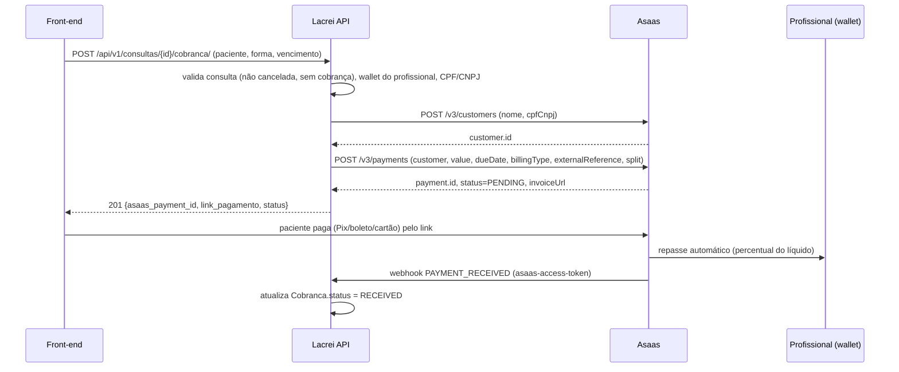

# Integração com o Asaas: split de pagamento

## Objetivo

Cobrar a consulta da pessoa paciente e **repassar automaticamente** a parte da pessoa profissional, deixando a taxa da plataforma na conta da Lacrei Saúde, sem transferências manuais.

## Conceitos do Asaas usados

- **Conta emissora**: conta Asaas da Lacrei, que cria as cobranças (chave em `ASAAS_API_KEY`).
- **walletId**: identificador da carteira Asaas de cada profissional (subconta criada via API ou conta própria). Fica salvo em `Profissional.asaas_wallet_id`.
- **Split**: no `POST /v3/payments`, o campo `split: [{walletId, percentualValue}]` divide o valor recebido. O percentual incide sobre o **valor líquido** (após as taxas do Asaas), e o que não é repassado fica na conta emissora. A carteira da própria conta emissora não pode ser destino do split.
- **Webhook**: o Asaas notifica mudanças de status das cobranças (ex.: `PAYMENT_RECEIVED`, `PAYMENT_CONFIRMED`, `PAYMENT_OVERDUE`, `PAYMENT_REFUNDED`) enviando o token configurado no cabeçalho `asaas-access-token`.

Referências: [Split de pagamento](https://docs.asaas.com/docs/split-de-pagamentos) · [Split em cobranças avulsas](https://docs.asaas.com/docs/split-em-cobrancas-avulsas) · [Webhooks de cobranças](https://docs.asaas.com/docs/webhook-para-cobrancas)

## Fluxo



## Implementação

| Arquivo | Responsabilidade |
|---|---|
| `apps/pagamentos/asaas.py` | `AsaasClient` (HTTP real, timeout, `User-Agent`, erros viram `AsaasError` sem logar dados pessoais) e `AsaasMockClient` (mesmo contrato, em memória) |
| `apps/pagamentos/services.py` | Regras: `gerar_cobranca()` e `processar_webhook()` (idempotente) |
| `apps/pagamentos/views.py` | `POST/GET /consultas/{id}/cobranca/` e `POST /pagamentos/webhook/asaas/` |
| `apps/pagamentos/models.py` | `Cobranca`: guarda só IDs do Asaas, valor, forma, vencimento, percentual e status |

### Exemplo

```bash
curl -X POST http://localhost:8000/api/v1/consultas/1/cobranca/ \
  -H "Authorization: Bearer $TOKEN" -H "Content-Type: application/json" \
  -d '{
        "paciente_nome": "Maria Silva",
        "paciente_cpf_cnpj": "529.982.247-25",
        "paciente_email": "maria@exemplo.com",
        "forma_pagamento": "PIX",
        "vencimento": "2026-12-01"
      }'
```

Payload enviado ao Asaas (`POST /v3/payments`):

```json
{
  "customer": "cus_000005219613",
  "billingType": "PIX",
  "value": 150.0,
  "dueDate": "2026-12-01",
  "description": "Consulta com Dra. Alex Souza",
  "externalReference": "consulta:1",
  "split": [{ "walletId": "0b763922-aa88-4cbe-a567-e3fe8511fa06", "percentualValue": 90.0 }]
}
```

## Configuração

| Variável | Padrão | Descrição |
|---|---|---|
| `ASAAS_MOCK` | `true` | `true` usa o mock; `false` chama a API real |
| `ASAAS_API_URL` | `https://api-sandbox.asaas.com/v3` | Em produção: `https://api.asaas.com/v3` |
| `ASAAS_API_KEY` | vazio | Chave da conta emissora (obrigatória com `ASAAS_MOCK=false` em staging/produção) |
| `ASAAS_WEBHOOK_TOKEN` | vazio | Token configurado no painel do Asaas; sem ele o webhook recusa tudo |
| `ASAAS_PERCENTUAL_PROFISSIONAL` | `90` | Percentual do valor líquido repassado à pessoa profissional |

Para testar no sandbox: crie uma conta em `sandbox.asaas.com`, gere a chave de API, crie uma subconta para obter um `walletId`, cadastre-o no profissional (`PATCH /api/v1/profissionais/{id}/` com `asaas_wallet_id`) e defina `ASAAS_MOCK=false`.

## Decisões e cuidados

- **LGPD / minimização**: o CPF/CNPJ da pessoa paciente vai direto ao Asaas e **não** é salvo no banco da Lacrei; guardamos só o `asaas_customer_id`. Os logs registram apenas IDs e status HTTP.
- **Webhook fail-closed**: sem `ASAAS_WEBHOOK_TOKEN` configurado, todas as chamadas recebem 403. A comparação do token é feita em tempo constante (`hmac.compare_digest`).
- **Webhook sempre 200 para eventos autenticados**, inclusive desconhecidos, para que o Asaas não pause a fila de notificações.
- **Idempotência**: uma consulta tem no máximo uma cobrança (OneToOne + verificação com retorno 409), e o webhook pode ser reprocessado sem efeitos colaterais.
- **Falhas do Asaas** retornam 502 ao cliente, sem expor detalhes, e são logadas em `lacrei.pagamentos`.

## Próximos passos

- Validar a autenticidade do webhook também por IP de origem e registrar o `id` de cada evento para deduplicação.
- Criar subcontas dos profissionais via API (`POST /v3/accounts`) no onboarding, salvando o `walletId` automaticamente.
- Reaproveitar o cliente Asaas pelo CPF (`GET /v3/customers?cpfCnpj=`) em vez de criar um a cada cobrança.
- Processar chamadas ao Asaas em fila (Celery/SQS) com retentativas e `externalReference` como chave de idempotência.
- Cancelar a cobrança (`DELETE /v3/payments/{id}`) automaticamente quando a consulta for cancelada.
