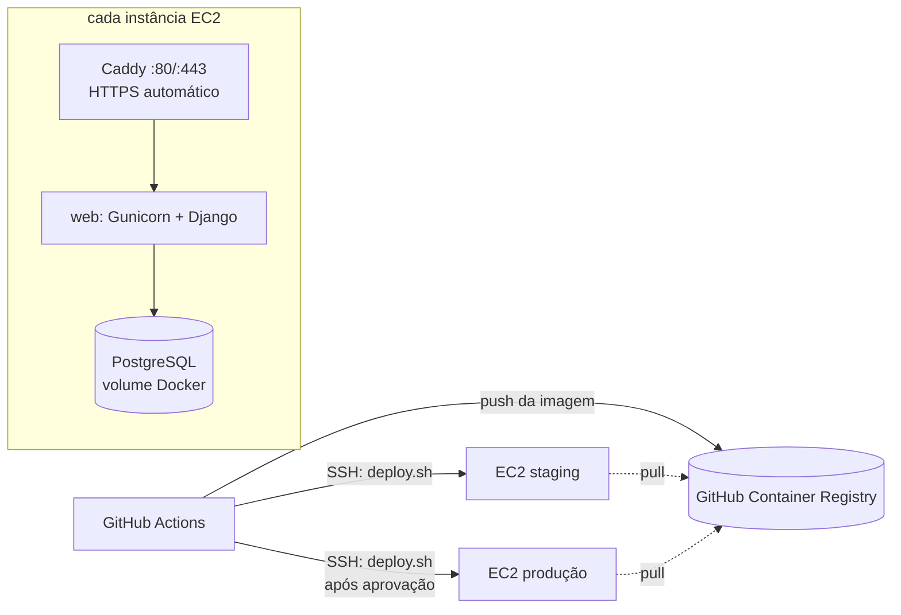

# Deploy na AWS (EC2 + Docker Compose)

## Arquitetura



- **Uma instância por ambiente**: isolamento total de dados, segredos e recursos.
- **Mesma imagem** (`sha-<commit>`) promovida de staging para produção.
- Para economizar no começo, é possível rodar os dois ambientes **na mesma instância**: use diretórios diferentes (`/opt/lacrei/staging` e `/opt/lacrei/production`) e, no staging, `HTTP_PORT=8080`/`HTTPS_PORT=8443` (ou um único Caddy na frente roteando por domínio). Para a entrega, o recomendado é uma instância por ambiente.

## Caminho usado neste projeto: 1 instância + sslip.io

Staging e produção rodam na **mesma EC2**, isolados por diretório (`/opt/lacrei/staging` e `/opt/lacrei/production`), com banco, volumes e `.env` próprios. Como não há domínio próprio, o endereço vem do [sslip.io](https://sslip.io): `54-12-34-56.sslip.io` resolve para `54.12.34.56`, e o Caddy emite o certificado HTTPS para ele.

| Ambiente | URL | Portas |
|---|---|---|
| Produção | `https://<ip-com-hifens>.sslip.io` | 80 / 443 (HTTPS automático) |
| Staging | `http://<ip-com-hifens>.sslip.io:8080` | 8080 (HTTP) |

1. **EC2 → Launch instance** (região `sa-east-1`, São Paulo)
   - Nome `lacrei-api`, AMI **Ubuntu Server 24.04 LTS**, tipo `t3.small` ou `t3.micro` (use o que aparecer como *Free tier eligible*), disco de 20 GB gp3
   - Key pair: opcional (o acesso administrativo pode ser feito pelo **EC2 Instance Connect** no navegador)
   - Security Group: SSH 22, HTTP 80, HTTPS 443 e TCP 8080, todos de `0.0.0.0/0`. O SSH só aceita chave; não há login por senha.
   - **Advanced details → User data**: cole o conteúdo de [`deploy/ec2-user-data.sh`](../deploy/ec2-user-data.sh) com `__DEPLOY_PUBKEY__` substituído pela chave pública de deploy e `__GITHUB_REPO__` por `usuario/repositorio`
2. Aguarde cerca de 3 minutos (o script instala Docker, cria swap e gera os `.env` com segredos aleatórios) e anote o **IP público**.
3. Cadastre os Environments e secrets no GitHub (tabela da seção 3; aqui `SSH_HOST` é o mesmo IP nos dois ambientes) e crie a variável `DEPLOY_ENABLED=true`.
4. Rode o workflow **CI/CD** e aprove o job de produção.
5. Senha do usuário `admin` da API: **EC2 → Connect → EC2 Instance Connect** e `sudo cat /root/lacrei-info.txt`.

> Não associe um Elastic IP *depois* do boot sem atualizar os `.env`: o endereço sslip.io é calculado a partir do IP do primeiro boot. O IP automático só muda se a instância for **parada**; reiniciar (reboot) não muda.

As seções abaixo descrevem o caminho com **duas instâncias e domínio próprio**, que é a evolução recomendada.

## 1. Criar as instâncias

No console da AWS (região `sa-east-1`, São Paulo, ou `us-east-1`, mais barata):

1. **EC2 → Launch instance**
   - Nome: `lacrei-api-staging` (repita depois para `lacrei-api-production`)
   - AMI: **Ubuntu Server 24.04 LTS**
   - Tipo: `t3.micro` (free tier) ou `t3.small` (mais folga para Postgres + Gunicorn)
   - Key pair: crie uma para o **seu** acesso administrativo
   - Armazenamento: 20 GB gp3
2. **Security Group**
   - `22/tcp`: apenas o seu IP. Para o GitHub Actions, há duas opções: liberar 22 para `0.0.0.0/0` com autenticação **só por chave** (mais simples para o desafio) ou usar AWS SSM/self-hosted runner (mais seguro, ver melhorias).
   - `80/tcp` e `443/tcp`: `0.0.0.0/0`
3. **Elastic IP**: aloque um e associe a cada instância (o IP não muda ao reiniciar).
4. **DNS**: crie registros `A`, como `staging-api.seudominio.com.br` e `api.seudominio.com.br`, apontando para os IPs elásticos. Sem domínio? Use `SITE_ADDRESS=:80`, `DJANGO_SECURE_SSL_REDIRECT=false` e `DJANGO_SECURE_HSTS_SECONDS=0`, e acesse pelo IP via HTTP (só para demonstração).

## 2. Preparar o servidor

```bash
ssh -i sua-chave.pem ubuntu@<IP>

# Docker + Compose plugin
curl -fsSL https://get.docker.com | sudo sh
sudo usermod -aG docker ubuntu && newgrp docker
docker compose version

# Diretório do ambiente
sudo mkdir -p /opt/lacrei/staging && sudo chown ubuntu:ubuntu /opt/lacrei/staging
cd /opt/lacrei/staging
nano .env       # copie de deploy/.env.server.example e preencha os segredos
chmod 600 .env
```

> Em `t3.micro` (1 GB de RAM), crie um swap de 1–2 GB para evitar falta de memória durante o pull das imagens e as migrações:
> `sudo fallocate -l 2G /swapfile && sudo chmod 600 /swapfile && sudo mkswap /swapfile && sudo swapon /swapfile && echo '/swapfile none swap sw 0 0' | sudo tee -a /etc/fstab`

## 3. Chave de deploy do GitHub Actions

Gere uma chave **exclusiva** para o pipeline (não reutilize a sua):

```bash
# na sua máquina
ssh-keygen -t ed25519 -C "github-actions-deploy" -f lacrei_deploy -N ""
# copie a pública para o servidor
ssh-copy-id -i lacrei_deploy.pub ubuntu@<IP>
```

No GitHub: **Settings → Environments → New environment**, crie `staging` e `production` e cadastre em cada um:

| Nome | Tipo | Valor |
|---|---|---|
| `SSH_HOST` | Secret | IP elástico / DNS da instância do ambiente |
| `SSH_USER` | Secret | `ubuntu` |
| `SSH_PRIVATE_KEY` | Secret | conteúdo de `lacrei_deploy` (chave privada) |
| `DEPLOY_PATH` | Secret | `/opt/lacrei/staging` ou `/opt/lacrei/production` |
| `APP_URL` | Variable | `https://staging-api.seudominio.com.br` (sem barra no final) |

No environment **`production`**, ative **Required reviewers** (você mesmo): o deploy de produção fica aguardando aprovação depois que o staging passa.

## 4. Primeiro deploy

1. Crie a variável de repositório `DEPLOY_ENABLED` = `true` (*Settings → Secrets and variables → Actions → Variables*) e rode o workflow **CI/CD** de novo (ou faça um novo push na `main`). Acompanhe em **Actions**.
2. Aprove o job **Deploy (produção)** quando o staging estiver ok.
3. Crie o usuário de acesso em cada ambiente:

```bash
cd /opt/lacrei/production
IMAGE_NAME=ghcr.io/<usuario>/<repo> IMAGE_TAG=$(cat .deployed_tag) \
  docker compose -f docker-compose.prod.yml exec web python manage.py createsuperuser
```

4. Teste: `curl https://api.seudominio.com.br/health/` deve retornar `{"status": "ok", "version": "sha-..."}`.

> A imagem no GHCR herda a visibilidade do repositório. O pipeline faz `docker login` com o `GITHUB_TOKEN` do job, então funciona com repositório público ou privado.

## Operação do dia a dia

```bash
cd /opt/lacrei/production
export IMAGE_NAME=ghcr.io/<usuario>/<repo> IMAGE_TAG=$(cat .deployed_tag)
docker compose -f docker-compose.prod.yml ps
docker compose -f docker-compose.prod.yml logs -f web
docker compose -f docker-compose.prod.yml exec db pg_dump -U lacrei lacrei > backup_$(date +%F).sql
```

## Logs no CloudWatch (opcional)

Para centralizar, troque o driver de log do serviço `web` em `deploy/docker-compose.prod.yml`:

```yaml
logging:
  driver: awslogs
  options:
    awslogs-region: sa-east-1
    awslogs-group: /lacrei/api/production
    awslogs-create-group: "true"
```

E associe à instância uma IAM Role com `logs:CreateLogGroup`, `logs:CreateLogStream` e `logs:PutLogEvents`. Como os logs já são JSON, dá para filtrar no CloudWatch Logs Insights (`fields status, path, duration_ms | filter status >= 500`).

## Evolução recomendada

| Hoje | Próximo passo |
|---|---|
| Postgres em container na EC2 | **RDS PostgreSQL** (backups automáticos, Multi-AZ): basta remover o serviço `db` e apontar `DATABASE_URL` |
| SSH na porta 22 | **AWS SSM Run Command** + OIDC do GitHub (sem porta aberta nem chave de longa duração) |
| GHCR | **ECR** (se a política exigir tudo dentro da AWS) |
| EC2 + Compose | **ECS Fargate + ALB** com deploy blue/green pelo CodeDeploy |
