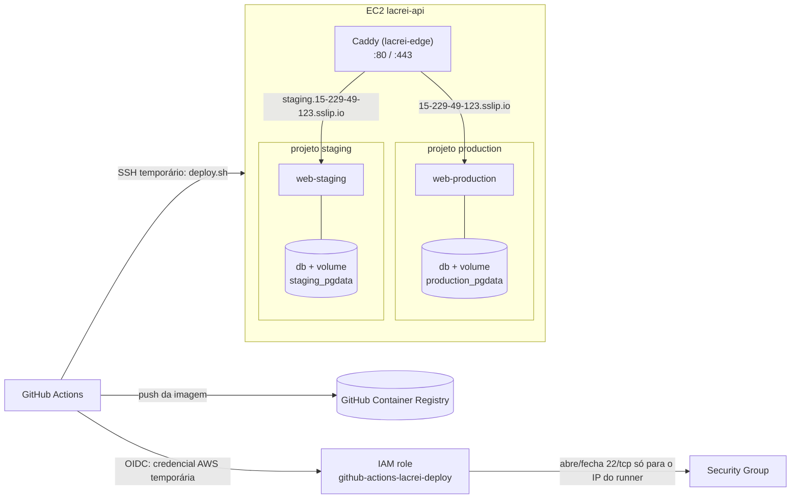

# Deploy na AWS (EC2 + Docker Compose)

## Arquitetura

Staging e produção rodam na **mesma instância EC2** (`lacrei-api`, `t3.micro`, `sa-east-1`), isolados entre si. Um único proxy (Caddy) recebe todo o tráfego em HTTPS na porta 443 e encaminha pelo nome do host.



| Ambiente | URL | Diretório na EC2 |
|---|---|---|
| Produção | https://15-229-49-123.sslip.io | `/opt/lacrei/production` |
| Staging | https://staging.15-229-49-123.sslip.io | `/opt/lacrei/staging` |
| Proxy | portas 80 e 443 | `/opt/lacrei/edge` |

O endereço vem do [sslip.io](https://sslip.io): `15-229-49-123.sslip.io` (e qualquer subdomínio dele) resolve para `15.229.49.123`, e o Caddy emite certificados Let's Encrypt para os dois hosts.

## Segregação entre os ambientes

| Recurso | Staging | Produção | Compartilhado? |
|---|---|---|---|
| Projeto Docker Compose | `staging` | `production` | Não |
| Containers | `staging-web-1`, `staging-db-1` | `production-web-1`, `production-db-1` | Não |
| Banco de dados | PostgreSQL próprio | PostgreSQL próprio | Não |
| Volume de dados | `staging_pgdata` | `production_pgdata` | Não |
| Rede do banco | `staging_backend` (interna, sem internet) | `production_backend` (interna, sem internet) | Não |
| Segredos (`.env`, 600, dono `ubuntu`) | `/opt/lacrei/staging/.env` | `/opt/lacrei/production/.env` | Não: `SECRET_KEY`, senha do banco, senha do admin e token do webhook são gerados separadamente |
| Configuração não sensível | GitHub Environment `staging` (`APP_URL`) | GitHub Environment `production` (`APP_URL`) | Não |
| Credenciais de deploy | Environment `staging` | Environment `production` (exige aprovação manual) | Mesma chave SSH de deploy, escopos de Environment separados |
| Rede `lacrei-edge` | `web-staging` | `web-production` | Sim, apenas proxy e containers `web`; os bancos não participam |
| Proxy (Caddy) | host `staging.…` | host principal | Sim |

**Como isso é comprovado:** ao fim de cada deploy de produção, o pipeline executa `scripts/segregation-report.sh` na EC2 e publica o resultado no resumo da execução. O relatório lista containers, redes, volumes, permissões dos `.env`, confirma que cada segredo é **diferente** entre os ambientes (sem exibir valores) e testa que o `web` de um ambiente **não alcança** o banco do outro.

**Limites desta abordagem, e por que é aceitável aqui:** os dois ambientes dividem CPU, memória, disco e kernel. Uma sobrecarga no staging pode afetar a produção, e um comprometimento do host afeta os dois. Para o escopo do desafio (free tier), a separação lógica acima é suficiente. A evolução recomendada é uma instância (ou conta AWS) por ambiente, com RDS (veja o fim deste documento).

## Segurança de rede

### Regras do Security Group `launch-wizard-1`

| Porta | Origem | Para quê |
|---|---|---|
| 80/tcp | `0.0.0.0/0` | Redirecionar para HTTPS e emitir certificados (desafio HTTP-01) |
| 443/tcp | `0.0.0.0/0` | API (produção e staging) |
| 22/tcp | Prefix list `com.amazonaws.sa-east-1.ec2-instance-connect` | Acesso administrativo pelo EC2 Instance Connect (autenticado pelo IAM e auditado no CloudTrail) |
| 22/tcp | `IP do runner/32`, **temporária** | Criada no início do job de deploy e removida ao final, mesmo em caso de falha |

A porta 22 **não fica aberta para a internet** e a antiga porta 8080 do staging foi **fechada**: o staging agora passa pelo mesmo proxy, em HTTPS na 443.

### SSH temporário via OIDC (sem chaves AWS no GitHub)

O workflow `deploy.yml`:

1. Obtém credenciais AWS de curta duração assumindo o papel `github-actions-lacrei-deploy` via OIDC (`aws-actions/configure-aws-credentials`). Não há chave de acesso AWS guardada no GitHub.
2. Descobre o IP público do runner e cria a regra `22/tcp IP/32` com a descrição `github-actions-<run_id>`.
3. Faz o deploy e os smoke tests.
4. Revoga a regra (`if: always()`).

O papel só pode ser assumido por workflows **deste repositório** (condição `token.actions.githubusercontent.com:sub = repo:ffabricioffs/lacrei-consultas.api:*`). Ele só tem duas permissões, restritas a este Security Group:

```json
{
  "Version": "2012-10-17",
  "Statement": [{
    "Sid": "SshTemporarioNoDeploy",
    "Effect": "Allow",
    "Action": ["ec2:AuthorizeSecurityGroupIngress", "ec2:RevokeSecurityGroupIngress"],
    "Resource": "arn:aws:ec2:sa-east-1:630758947048:security-group/sg-08c9c0560dd5f9f9a"
  }]
}
```

Variáveis de repositório usadas pelo workflow (*Settings → Secrets and variables → Actions → Variables*):

| Variável | Valor |
|---|---|
| `AWS_DEPLOY_ROLE_ARN` | `arn:aws:iam::630758947048:role/github-actions-lacrei-deploy` |
| `AWS_REGION` | `sa-east-1` |
| `AWS_SECURITY_GROUP_ID` | `sg-08c9c0560dd5f9f9a` |
| `DEPLOY_ENABLED` | `true` |

### Recomendações adicionais

| Recomendação | Situação |
|---|---|
| Fechar a porta 22 para a internet | ✅ Feito (SSH temporário por execução + Instance Connect) |
| Fechar a porta própria do staging (8080) | ✅ Feito (staging atrás do proxy, em HTTPS na 443) |
| Restringir o staging a IPs da equipe ou VPN | Recomendado quando o staging deixar de ser avaliado publicamente: adicionar `remote_ip` ou `basic_auth` ao bloco do staging no `deploy/edge/Caddyfile` |
| Substituir SSH por AWS Systems Manager (SSM Run Command) | Próximo passo: elimina a porta 22 por completo e a chave SSH de deploy |
| Rotacionar a chave SSH de deploy | A cada 90 dias ou ao trocar a equipe: gerar nova chave, atualizar `authorized_keys` e o secret `SSH_PRIVATE_KEY` |
| Alerta de custos | ✅ Orçamento "gasto zero" no AWS Budgets, com e-mail |

## Como recriar do zero

1. **EC2 → Launch instance**, na região `sa-east-1`:
   - **Instância:** Ubuntu Server 24.04 LTS, `t3.micro` e 20 GB gp3.
   - **Security Group:** portas 80 e 443 abertas, e a 22 apenas para o prefix list do EC2 Instance Connect.
   - **User data:** em *Advanced details → User data*, cole [`deploy/ec2-user-data.sh`](../deploy/ec2-user-data.sh), substituindo `__DEPLOY_PUBKEY__` e `__GITHUB_REPO__`. O script instala Docker, cria swap, autoriza a chave de deploy e gera os dois `.env` com segredos aleatórios criados na própria máquina.
2. **IAM → Identity providers → Add provider:** OpenID Connect, URL `https://token.actions.githubusercontent.com`, audience `sts.amazonaws.com`.
3. **IAM → Roles → Create role:** escolha Web identity e o provedor acima, organização `ffabricioffs`, repositório `lacrei-consultas.api`. Nomeie o papel `github-actions-lacrei-deploy` e adicione a política inline acima.
4. **GitHub → Settings → Environments:** crie `staging` e `production`, esta com *Required reviewers*. Em cada um, cadastre os secrets `SSH_HOST`, `SSH_USER`, `SSH_PRIVATE_KEY` e `DEPLOY_PATH` e a variável `APP_URL`. Depois crie as variáveis de repositório da tabela acima.
5. Faça push na `main`. O pipeline faz o resto: na primeira execução, o `deploy.sh` cria a rede `lacrei-edge`, sobe o proxy e grava os hosts.

## Operação do dia a dia

Acesse a instância pelo console: **EC2 → lacrei-api → Conectar → EC2 Instance Connect**.

```bash
cd /opt/lacrei/production
export IMAGE_NAME=ghcr.io/ffabricioffs/lacrei-consultas.api IMAGE_TAG=$(cat .deployed_tag) APP_ENV=production
docker compose -f docker-compose.prod.yml ps
docker compose -f docker-compose.prod.yml logs -f web
docker compose -f docker-compose.prod.yml exec db pg_dump -U lacrei lacrei > backup_$(date +%F).sql
./segregation-report.sh        # relatório de segregação entre os ambientes
sudo cat /root/lacrei-info.txt # URLs e senhas do usuário admin de cada ambiente
```

> O terminal do EC2 Instance Connect no navegador não aceita colar texto de uma vez em alguns navegadores. Se isso acontecer, digite os comandos.

## Logs

Finalidade, campos, acesso e retenção estão em [LOGS.md](LOGS.md). Para centralizar no CloudWatch, troque o driver de log do serviço `web` em `deploy/docker-compose.prod.yml`:

```yaml
logging:
  driver: awslogs
  options:
    awslogs-region: sa-east-1
    awslogs-group: /lacrei/api/production
    awslogs-create-group: "true"
```

Associe à instância uma IAM Role com `logs:CreateLogGroup`, `logs:CreateLogStream` e `logs:PutLogEvents`. Depois defina a retenção de 30 dias com `aws logs put-retention-policy --log-group-name /lacrei/api/production --retention-in-days 30`.

## Evolução recomendada

| Hoje | Próximo passo |
|---|---|
| Staging e produção na mesma EC2 | Uma instância (ou conta AWS) por ambiente |
| Postgres em container | **RDS PostgreSQL** com backups automáticos: remover o serviço `db` e apontar `DATABASE_URL` |
| SSH temporário por execução | **AWS SSM Run Command** com o mesmo papel OIDC, sem porta 22 |
| GHCR | **ECR**, se a política exigir tudo dentro da AWS |
| EC2 + Compose | **ECS Fargate + ALB** com deploy blue/green pelo CodeDeploy |
