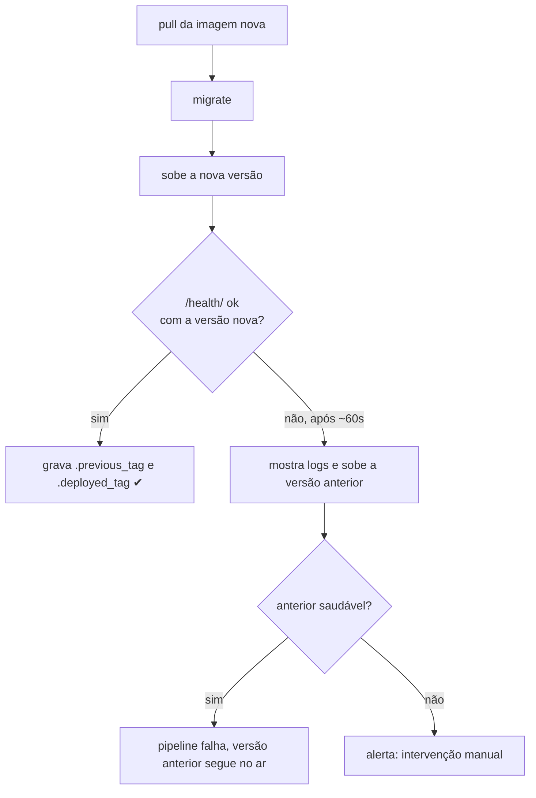

# Estratégia de rollback

**Objetivo:** voltar à última versão saudável em segundos, sem rebuild e sem intervenção manual quando a falha é detectável automaticamente.

## Pilares

1. **Imagens imutáveis e versionadas.** Cada commit na `main` gera `ghcr.io/<repo>:sha-<commit>`. Voltar uma versão é trocar a tag, não recompilar.
2. **Healthcheck com versão.** `/health/` retorna `status`, estado do banco e `version` (a tag da imagem). O deploy só é considerado bem-sucedido quando a versão **nova** responde `ok`.
3. **Estado de release no servidor.** `.deployed_tag` (versão no ar) e `.previous_tag` (anterior) ficam em cada diretório de ambiente.
4. **Migrações compatíveis (expand/contract).** A versão N-1 precisa funcionar com o schema da versão N.

## Camada 1: rollback automático no servidor (`scripts/deploy.sh`)



## Camada 2: rollback automático no pipeline

Depois do `deploy.sh`, o workflow faz um **smoke test externo** (pela internet, passando por DNS, Caddy e TLS). Se ele falhar, o step `Rollback se o smoke test falhar` executa `rollback.sh` por SSH. Esse step só roda quando o deploy no servidor passou e o smoke test falhou, para não reverter duas vezes.

Como produção exige aprovação manual **depois** do staging, uma versão quebrada normalmente é barrada antes de chegar lá.

## Camada 3: rollback manual (revert pelo GitHub Actions)

Para problemas que o healthcheck não pega (bug de regra de negócio, por exemplo):

**Pela interface:** *Actions → Rollback → Run workflow*

- `environment`: `staging` ou `production`
- `image_tag`: vazio = versão anterior; ou uma tag específica, como `sha-1a2b3c4` (as tags ficam no GHCR e no histórico de execuções do CI/CD)

**Direto no servidor (emergência):**

```bash
cd /opt/lacrei/production
IMAGE_NAME=ghcr.io/<usuario>/<repo> ./rollback.sh               # versão anterior
IMAGE_NAME=ghcr.io/<usuario>/<repo> ./rollback.sh sha-1a2b3c4   # versão específica
```

**Pelo Git (corrigindo o histórico):** `git revert <commit> && git push`. O pipeline normal gera e implanta uma nova imagem sem o commit problemático. É o caminho certo depois que o rollback rápido estabilizou o ambiente.

> Depois de um rollback, `.previous_tag` passa a apontar para a versão revertida (comportamento de troca, como no blue/green). Para avançar de novo, faça um novo deploy pelo pipeline.

## Migrações e rollback

O `rollback.sh` **não** desfaz migrações (`SKIP_MIGRATIONS=true`), porque desfazer schema automaticamente pode apagar dados. Para isso funcionar, as migrações seguem **expand/contract**:

| Mudança | Como fazer |
|---|---|
| Adicionar coluna | Sempre `null=True` ou com `default`, para que o código antigo continue inserindo sem ela |
| Remover coluna | Release 1: o código para de usar a coluna. Release 2: a migração remove |
| Renomear coluna | Adicionar a nova, copiar os dados, passar a usar a nova e só depois remover a antiga |
| Migração destrutiva inevitável | Backup antes (`pg_dump`), janela de manutenção e reversão manual documentada no PR |

## Alternativas avaliadas

| Estratégia | Prós | Contras | Decisão |
|---|---|---|---|
| **Troca de tag + healthcheck (atual)** | Simples, rápido, sem custo extra | Alguns segundos de reinício do container | ✅ adotada |
| Blue/Green com dois containers e troca no Caddy | Zero downtime | Dobra memória na EC2 pequena, mais scripts | evolução futura |
| Blue/Green ECS + CodeDeploy | Zero downtime, rollback nativo | Custo e complexidade maiores | quando migrar para ECS |
| Preview deploy por PR | Valida antes do merge | Exige infraestrutura efêmera | fora do escopo |
